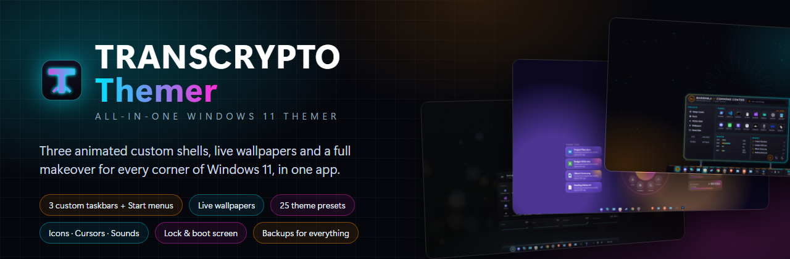
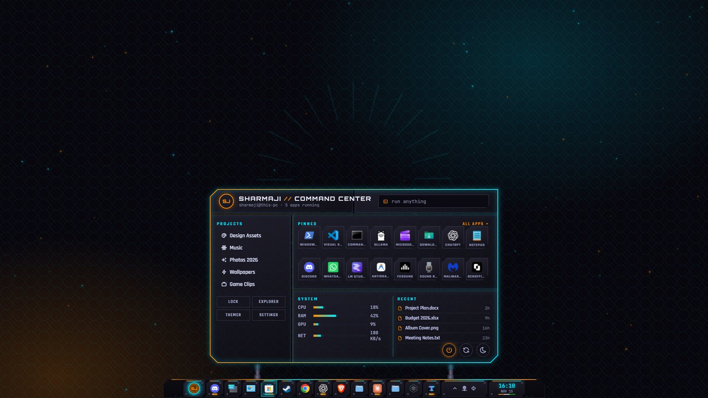
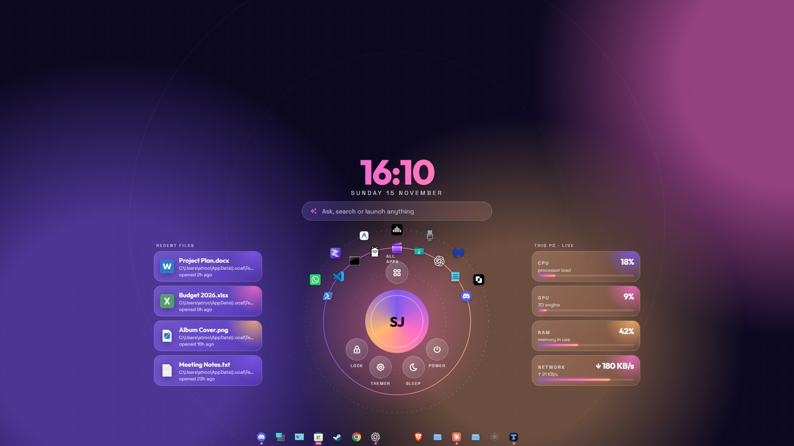
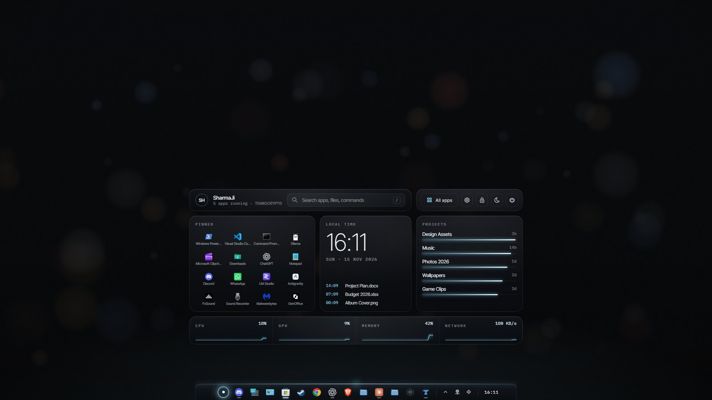
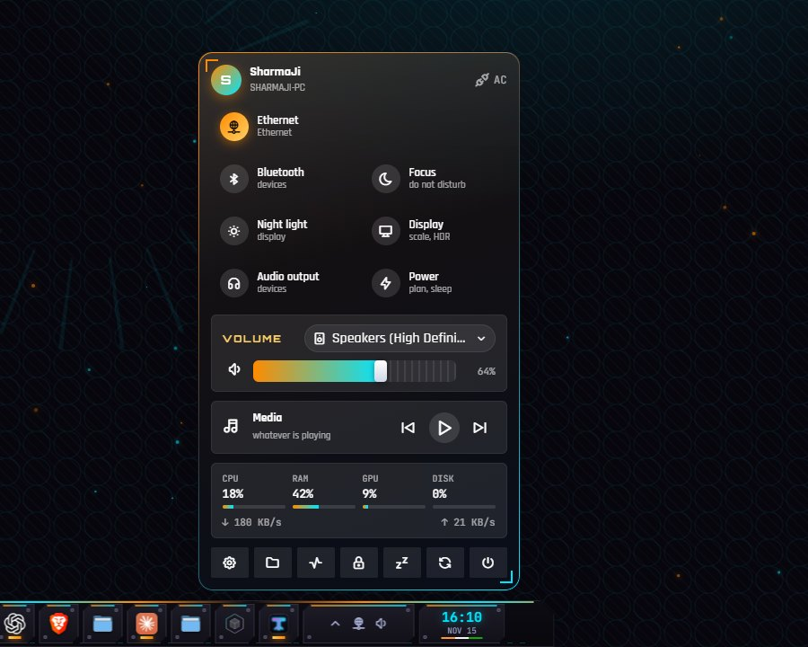
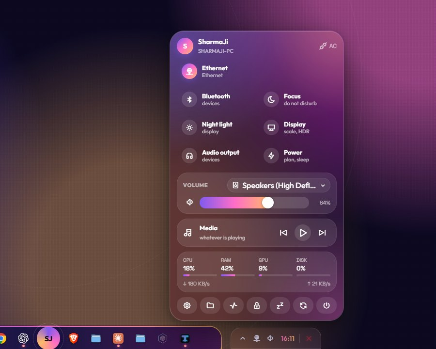
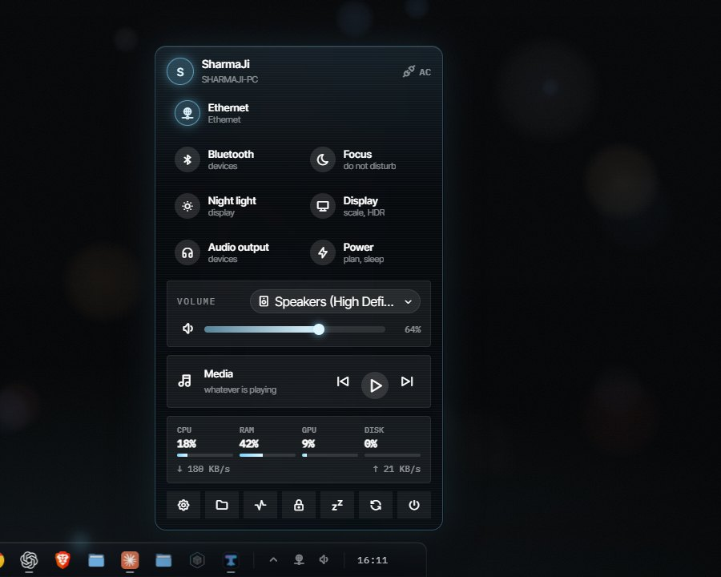
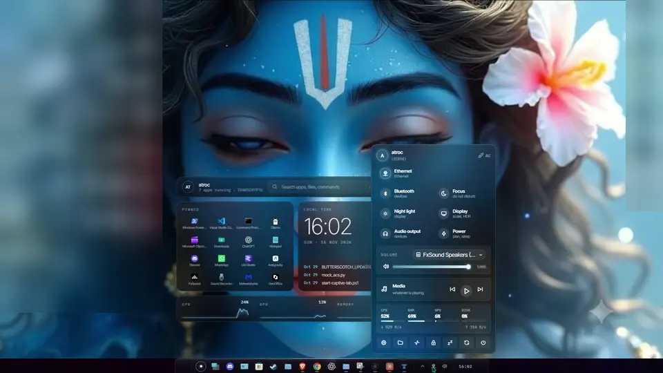
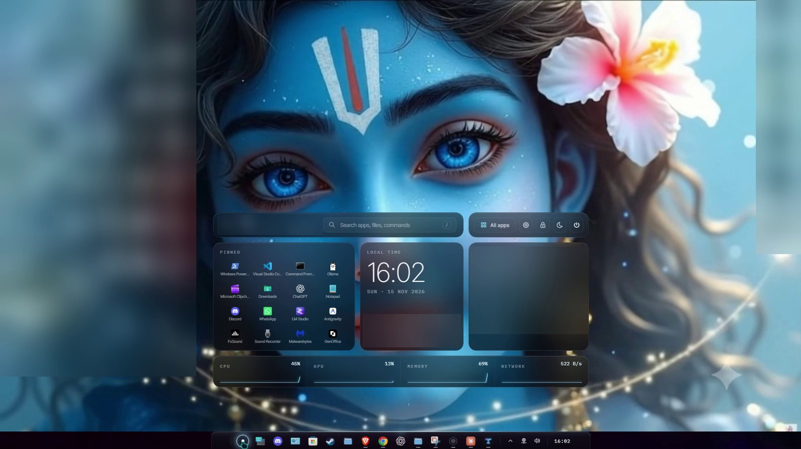

<p align="center">
  
</p>

<p align="center">
  <a href="https://github.com/mrsharmaji1301/TRANSCRYPTO-Themer/releases/latest"></a>
  
  
</p>

<p align="center"><b>Three animated custom shells, live wallpapers and a full makeover for every corner of Windows 11, in one app.</b><br>
Taskbar, Start menu, wallpapers, icons, cursors, sounds, lock and boot screens, fonts and File Explorer, with a backup for everything.</p>

<p align="center">
  
</p>

---

## Contents

- [The three custom shells](#the-three-custom-shells)
- [Live wallpapers](#live-wallpapers)
- [The Themer app](#the-themer-app)
- [All features](#all-features)
- [Installation](#installation)
- [Updating and uninstalling](#updating-and-uninstalling)
- [FAQ](#faq)
- [License](#license)

---

## The three custom shells

TRANSCRYPTO can replace the Windows taskbar and Start menu with one of three fully animated shells. Each one brings its own taskbar, Start menu, quick settings, notification centre, live scene, icon pack and preset. Your real running apps, your pinned apps, the tray, the clock and notifications all work as usual.

### SharmaJi Command Center
A saffron × cyan HUD: pin tiles, projects, recent files and live system gauges. Three palettes (SharmaJi, TRANSCRYPTO, Alien).



### Orbital
Your apps orbit a glowing core. All Apps sits on the ring, recent files on the left and live CPU, GPU, RAM and network cards on the right.



### Projector
A cinematic glass Start menu with pinned apps, a big clock, projects and live graphs.



### Quick settings, on every shell

| SharmaJi Command Center | Orbital | Projector |
|---|---|---|
|  |  |  |

Network, Bluetooth, focus, night light, display, power, a volume slider with an audio output picker, media controls and live system stats. Open it from the tray or with **Win+A**. **Win+N** opens the notification centre.

**What works the way you expect**
- The **Win** key opens the custom Start menu and **Esc** closes it. Right-click Start for Task Manager, Settings, Run, Terminal and Power.
- Apps with several windows show a window list. Right-click any app or Start entry for **Run as administrator**, **Open file location**, **Uninstall** and more.
- Drag icons to reorder them, and drop files or folders on an app to open them with it.
- Hidden tray icons open in the shell's own panel, with their real click and right-click menus.
- Fullscreen games and videos get the whole screen: the bar steps aside.
- The shell runs as you, never as administrator. If it ever stops, the normal Windows taskbar comes back by itself within seconds.

---

## Live wallpapers

Play any video as your desktop wallpaper, behind your icons, or pick one of the animated live scenes made for the three shells.

<p align="center"></p>

- **Video wallpapers**: MP4 and other formats, one per monitor or the same on all, with hardware decoding.
- **Live scenes**: animated backgrounds for SharmaJi, Orbital and Projector, in each palette.
- **Smart pause**: it pauses while a fullscreen app or game runs, on battery, while the PC is locked, and (optionally) behind maximised windows.
- **Library**: drag and drop your files, or use **Add from URL**.
- **Live Lock**: your video as a lock screen before Windows asks for your PIN.



---

## The Themer app

A native Windows app with a glass and neon interface. Pick a preset, then fine-tune any part in its own tab. The top-right menu has **Help & guide**, a searchable **Features & knowledge base** (what every option changes in Windows, down to the registry value), **What's new**, **Check for updates** and **About**.

---

## All features

| Area | What you can do |
|---|---|
| **Themes** | 25 one-click presets: TRANSCRYPTO Neon, Catppuccin Latte and Mocha, Dracula, Nord, Nord Snow Storm, Tokyo Night, Gruvbox Dark and Light, Rosé Pine and Rosé Pine Dawn, One Dark, Everforest, Solarized Light, Sakura, Ocean Deep, Synthwave Sunset, Neon Night, Matrix, Mono Paper, Midnight Mono, Windows 11 Default, plus SharmaJi Command Center, Orbital and Projector. Live preview, **My Themes**, and `.tctheme` export and import. |
| **Custom shells** | Three animated replacements for the taskbar and Start menu (see above), with palettes, auto-hide and a reserved strip like the real taskbar. |
| **Wallpapers** | Solid color, picture per monitor, slideshow, live video wallpaper and live scenes, with a library and Add from URL. |
| **Colors & accent** | Dark and light mode for Windows and apps, accent color with a generated palette, transparency, accent on Start, taskbar and title bars. |
| **Icons & thumbnails** | 24 icon packs (each with its own drive style), desktop icons, per-drive and per-folder icons, a folder cover maker, shortcut arrows on or off, thumbnail options and icon cache rebuild. |
| **Drive bars** | The free-space bars under each drive in This PC, drawn in your preset's style. |
| **Cursors** | 21 cursor packs with animated busy cursors, Windows schemes, import any pack (`install.inf` supported), per-pointer override, size from 20 to 256 px, and a neon **click effect** everywhere in Windows. |
| **Sounds** | Default, Minimal, Silent or your own packs, and a custom sound for any Windows event. |
| **Start menu** | Six layout presets with previews (or your own), the Recommended section on, off or removed, folders next to Power, and Bing web search on or off. |
| **Taskbar** | Six layout presets, alignment, buttons, combine, seconds on the clock, End task, auto-hide, multi-monitor and transparency, plus a colored taskbar skin and click ripple. |
| **File Explorer** | Classic right-click menu, compact view, file extensions and hidden files, Home and Gallery, the folder it opens to, snap, animations and menu delay. |
| **Lock & sign-in** | Lock screen picture (or a frame from a video), Live Lock, sign-in screen blur, tips and widgets. |
| **Boot screen** | Custom UEFI boot logo (bundled HackBGRT), Secure Boot and BitLocker checks, a BIOS guide per vendor, restart to BIOS, boot menu options, BCD backup and a custom startup sound. |
| **Fonts** | Replace the Windows UI font with any installed font (live preview), install fonts, text size and ClearType. |
| **Backup & restore** | Selective or full backups (`.tcbackup`), restore any part, **Restore Windows 11 defaults** for one section or everything, and System Restore points before big changes. |
| **Settings** | Start with Windows, engine control and memory, signed updates, reduce motion and the log. |

**Presets never fight your own changes.** A preset sets colors, wallpaper, icons, cursors and sounds. Anything you change yourself is saved on top of it, and tabs with your own changes get a dot. When you switch presets you choose **Keep my customizations** or **Apply full preset**.

---

## Installation

**Requirements:** Windows 11 (64-bit or ARM64). Everything else it needs (Microsoft WebView2 and .NET Framework 4.8) is already part of Windows 11. Nothing is downloaded during setup.

1. Download **`TRANSCRYPTO-Themer-Setup-<version>.exe`** from the [latest release](https://github.com/mrsharmaji1301/TRANSCRYPTO-Themer/releases/latest).
2. Run it. Windows SmartScreen may say *"Windows protected your PC"* because the installer is self-signed: click **More info → Run anyway**.
3. Accept the license, then choose:
   - the install folder (default `C:\Program Files\TRANSCRYPTO Themer`),
   - a desktop shortcut (off by default),
   - a Start menu shortcut,
   - whether to start TRANSCRYPTO when setup is done.
4. Click **Install** and approve the administrator prompt.
5. Open **TRANSCRYPTO Themer** from the Start menu, go to **Themes** and pick a preset. Try **SharmaJi Command Center**, **Orbital** or **Projector** for the full custom shell.

**Silent install** (for scripts):

```
TRANSCRYPTO-Themer-Setup-<version>.exe /S [/DESKTOP | /NODESKTOP] [/NOSTARTMENU] [/NOLAUNCH] [/D=C:\Path\To\Folder]
```

`/D=` must come last. A custom folder must be empty, on a local NTFS drive, and not a drive root or the Windows folder.

---

## Updating and uninstalling

- **Updates**: open the menu at the top right → **Check for updates**. Every update is signed, and TRANSCRYPTO refuses anything unsigned or altered. You can also install a downloaded `TRANSCRYPTO-Themer-<version>.zip` from **Settings → Updates → Install update file**.
- **Uninstall**: **Windows Settings → Apps → Installed apps → TRANSCRYPTO Themer → Uninstall**. Before you uninstall, use **Backup & Restore → Restore Windows 11 defaults** if you want every change undone first.
- **Your data** (wallpaper library, backups, your themes, imported packs, logs and settings) lives in `%LOCALAPPDATA%\TRANSCRYPTO`. The uninstaller asks whether to keep it.

---

## FAQ

<details>
<summary><b>Why does Windows say "Unknown publisher" or "Windows protected your PC"?</b></summary>

The installer is signed with TRANSCRYPTO's own self-signed certificate, not a paid one. The signature still proves the file was not changed, but SmartScreen does not know the publisher yet. Click **More info → Run anyway**. Only download it from this repository's Releases page.
</details>

<details>
<summary><b>Is it safe? Can I undo everything?</b></summary>

Yes. Before big changes TRANSCRYPTO creates a System Restore point. **Backup & Restore** can save and restore everything it manages, and **Restore Windows 11 defaults** puts any section, or everything, back to stock. A restore only touches the settings TRANSCRYPTO tracks; the knowledge base lists each one.
</details>

<details>
<summary><b>Why does it ask for administrator rights?</b></summary>

Some settings live in system-wide places: folder and drive icons, the lock screen, fonts, Start menu policies, the boot logo and restore points. The Themer window asks once when it starts. The custom shell and the live wallpaper engine always run as your normal user.
</details>

<details>
<summary><b>My taskbar is gone. How do I get the Windows taskbar back?</b></summary>

Open the Themer → **Taskbar** → Custom taskbar → Design: **Windows taskbar (off)**, or **Settings → Engine → Stop**. The Windows taskbar comes back at once. It also comes back by itself whenever the shell stops or crashes.
</details>

<details>
<summary><b>Does it slow down my PC or games?</b></summary>

No. The Themer window only runs while it is open. The engine is a small native program, and live wallpapers pause during fullscreen games and videos, on battery and when the PC is locked. The custom bar steps aside for fullscreen apps.
</details>

<details>
<summary><b>Does it work on Windows 10 or with several monitors?</b></summary>

It is built and tested for Windows 11. Wallpapers work per monitor. The custom shells run on the primary monitor.
</details>

<details>
<summary><b>Can I change the boot logo with Secure Boot on?</b></summary>

Yes. You approve the bundled HackBGRT boot loader once in the blue MOK screen on the next boot; the app shows the steps. A restore point and a BCD backup are made first.
</details>

<details>
<summary><b>Where are my settings and wallpapers stored?</b></summary>

In `%LOCALAPPDATA%\TRANSCRYPTO`: `library` (wallpapers), `backups`, `mythemes`, `sounds`, imported `icons` and `cursors`, `logs`, and the settings files.
</details>

<details>
<summary><b>I found a bug or have an idea. Where do I report it?</b></summary>

Open an [issue](https://github.com/mrsharmaji1301/TRANSCRYPTO-Themer/issues). Include your Windows version and, if possible, the log from **Settings → Log**.
</details>

<details>
<summary><b>Can I share it, sell it or use it in my business?</b></summary>

You can use it for free, as much as you like, on your own PCs. You may not redistribute it, publish modified versions or use it commercially. For commercial use, ask through an [issue](https://github.com/mrsharmaji1301/TRANSCRYPTO-Themer/issues). See [LICENSE.txt](LICENSE.txt).
</details>

---

## License

**Free to use. Not open source.** Copyright © 2026 SharmaJi (TRANSCRYPTO).

You may install and use TRANSCRYPTO Themer for free. You may not redistribute it (the installer, updates, code or artwork), publish modified versions, or use it commercially. Commercial use is reserved to SharmaJi (TRANSCRYPTO). Full terms: [LICENSE.txt](LICENSE.txt).

## Credits

HackBGRT © Lauri Kenttä (MIT License), bundled in `vendor\HackBGRT`. Preset palettes are inspired by the open-source Catppuccin, Dracula, Nord, Tokyo Night, Gruvbox, Rosé Pine, One Dark, Everforest and Solarized themes.

<p align="center">Made with ❤ by <b>SharmaJi</b></p>
